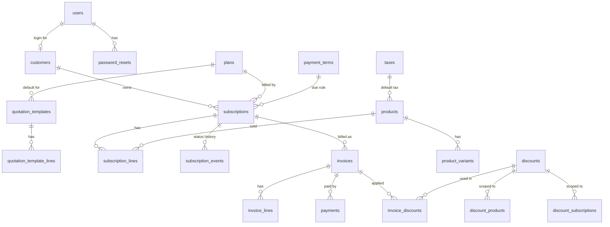

# 02 — Database design

File: `backend/migrations/001_init.sql`. **Verified:** applies cleanly on an empty PostgreSQL 16 database (23 tables, 51 indexes), loaded with 5,000 subscriptions / 20,000 invoices / 11,666 payments, and all 13 negative tests in `scripts/verify_constraints.sql` are refused by the database.

## ERD

## Tables by purpose

| Group | Tables | Notes |
|---|---|---|
| Identity | `users`, `password_resets`, `customers` | email is `CITEXT UNIQUE` (case-insensitive); reset stores only a token hash |
| Catalog | `products`, `product_variants`, `taxes`, `payment_terms` | variant `extra_price_minor` (Odoo brand = 56000) |
| Plans | `plans`, `quotation_templates`, `quotation_template_lines` | plan flags: `auto_close`, `closable`, `pausable`, `renewable` |
| Subscriptions | `subscriptions`, `subscription_lines`, `subscription_events` | status enum + immutable event timeline |
| Money | `invoices`, `invoice_lines`, `invoice_discounts`, `payments`, `discounts`, `discount_products`, `discount_subscriptions` | invoice totals stored (written in the same tx) so reports are plain sums |
| Platform | `email_outbox`, `idempotency_keys`, `audit_log` | scale + safety |

## Rules the database enforces (so bugs cannot be saved)

| # | Rule | Mechanism | Verified |
|---|---|---|---|
| 1 | one account per email, any letter case | `CITEXT UNIQUE` | ✅ |
| 2 | **never bill a period twice** | `UNIQUE (subscription_id, period_start)` | ✅ |
| 3 | cannot overpay | `CHECK (paid_minor <= total_minor)` | ✅ |
| 4 | `paid` status requires full payment | `CHECK (status <> 'paid' OR paid = total)` | ✅ |
| 5 | arithmetic always adds up | `CHECK (total = subtotal − discount + tax)` | ✅ |
| 6 | percent discount ≤ 100% | `CHECK (kind <> 'percent' OR value <= 10000)` | ✅ |
| 7 | discount cannot exceed its usage limit | `CHECK (used_count <= usage_limit)` | ✅ |
| 8 | discount dates ordered | `CHECK (end_date >= start_date)` | ✅ |
| 9 | subscription dates ordered | `CHECK (expiry_date >= start_date)` | ✅ |
| 10 | only active subscriptions have a billing date | `CHECK (status='active' OR next_billing_date IS NULL)` | ✅ |
| 11 | plan min quantity ≥ 1 | `CHECK (min_quantity >= 1)` | ✅ |
| 12 | prices never negative | `CHECK (... >= 0)` | ✅ |
| 13 | payments are positive | `CHECK (amount_minor > 0)` | ✅ |
| 14 | `paused` ⇔ `paused_at` set | `CHECK ((status='paused') = (paused_at IS NOT NULL))` | by construction |

Run the proof any time on a database loaded with `scripts/perf_seed.sql`: `psql -d brightloop_perf -f scripts/verify_constraints.sql` (each of the 13 statements must print an ERROR).

## Index catalog (each one has a query that needs it)

| Index | Serves |
|---|---|
| `idx_sub_status_id (status, id DESC)` | subscriptions list by status, keyset |
| `idx_sub_customer_id (customer_id, id DESC)` | portal "my subscriptions" |
| `idx_sub_due (next_billing_date) WHERE status='active'` | billing engine due scan (tiny partial index) |
| `idx_inv_status_id`, `idx_inv_customer_id` | invoices list, portal invoices |
| `idx_inv_open_due (due_date) WHERE confirmed AND unpaid` | outstanding + overdue totals, chase list |
| `idx_pay_date_amt (paid_on) INCLUDE (amount_minor)` | revenue sums as index-only scans |
| `idx_*_trgm` (GIN, `pg_trgm`) | fast `ILIKE '%text%'` search on customer name, subscription and invoice numbers |
| `idx_outbox_pending` | mail worker picks next pending rows |
| FK indexes on lines, payments, events | detail pages |

## Measured (5k subs / 20k invoices, single local Postgres, `scripts/perf_queries.sql`)

| Query | Time |
|---|---|
| subscriptions list, status filter, keyset page | 2.6 ms |
| invoices list for one customer (portal) | 0.7 ms |
| billing due scan | 0.9 ms |
| dashboard: active subscriptions | 1.0 ms |
| dashboard: revenue in a date range | 2.3 ms |
| dashboard: outstanding + overdue | 2.2 ms |
| revenue by month | 7.1 ms |
| customer name search | 2.2 ms |
| invoice detail + lines | 0.5 ms |

Budget from the brief: every page under 2 s. Database share is under 10 ms at this size; the rest is API and UI. Re-run these at the end and paste the new numbers in the README.

## Migration policy

- Numbered files `001_`, `002_` … applied in order by a 30-line runner that records versions in `schema_migrations`.
- Never edit an applied migration after both teammates pulled it. Change the schema with a new file.
- `002_reference.sql` (idempotent) inserts only reference rows the app cannot run without: payment terms (Immediate, Net 15, Net 30) and the default tax rules. Demo business data is created by `cmd/seed` through the services.
